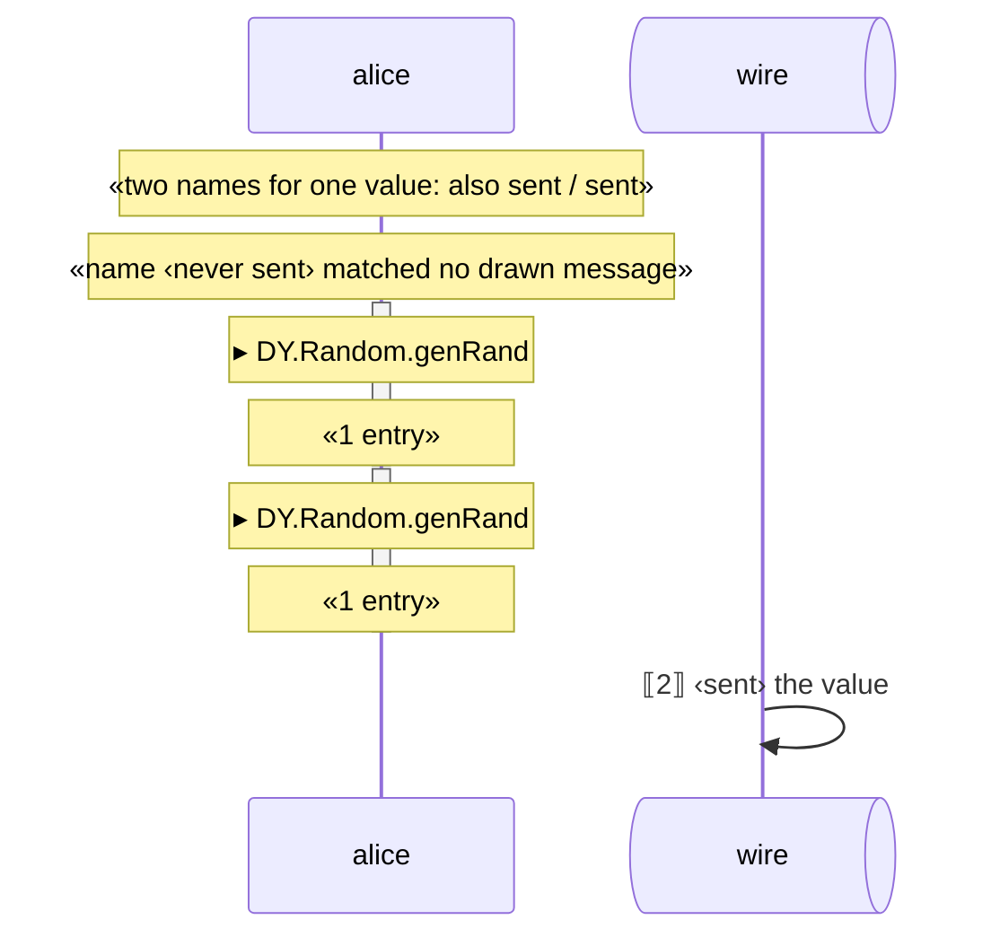
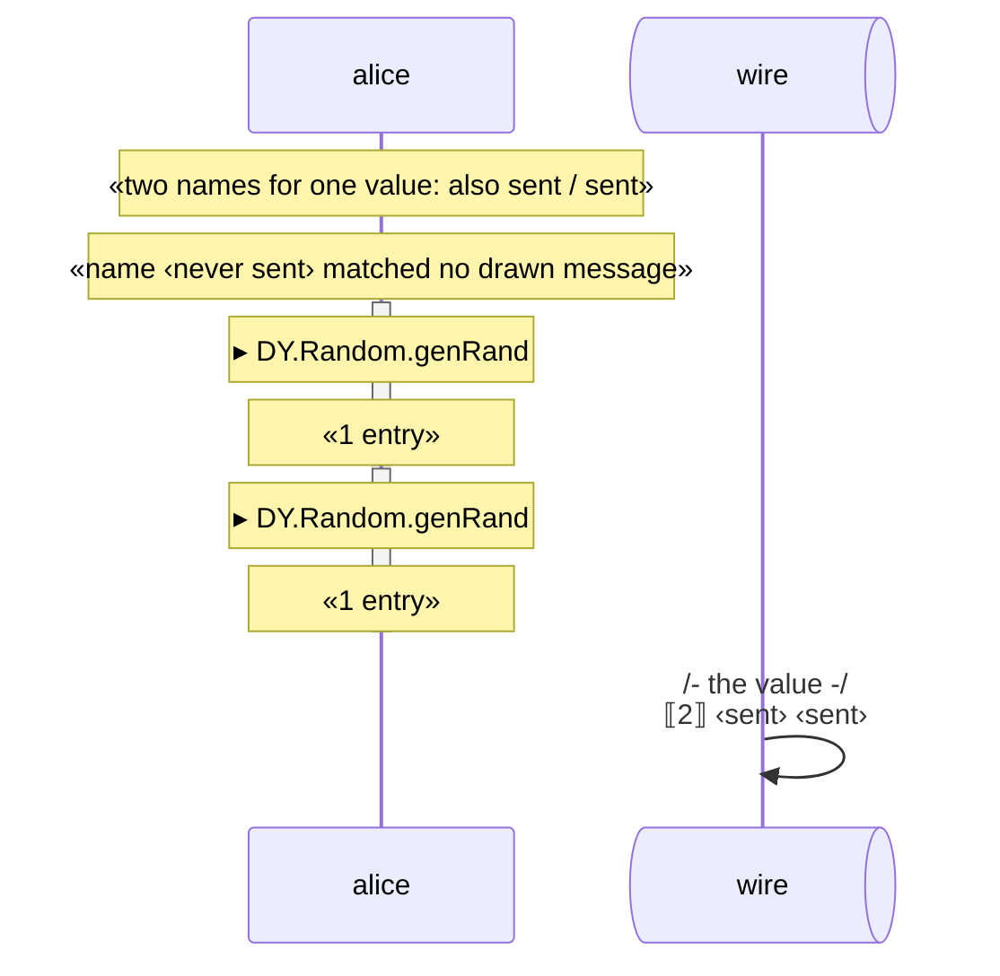

# DYVis — a name conflict and a name that reached nothing

## Overview

## Terms

The same run with the bytes shown.

## Legend

| | |
|---|---|
| `▸ Name` | a step; `Name` is the definition it calls |
| `/- … -/` | comment, maybe helpful for understanding the step |
| `· name` | an event the step logged, named by its constructor |
| `‹name›` | what the author called that value — declared, not derived |
| `⟦n⟧` | the trace handle of the message |
| `f:n(x)` | a constructor of the byte algebra `f`, and the term's instance number `n` |
| `concat:n[a, b]` | a concatenation, flattened |
| `concat:n[a, concat:k]` | `k` kept whole: it is also a message on the wire |
| `f:n`, `concat:n` | that same term again; its structure is printed once, earlier |
| `x ×n` | n adjacent copies of that same term |
| `?:n` | a term without formatting information |
| `…` | the depth limit cut here |
| `«n entries»` | omitted trace entries |
| `— REJECTED` | the driver returned `none`; the run stopped there |

